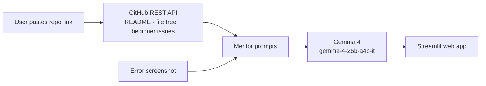

<div align="center">

# 🤝 First PR Buddy

**Your AI mentor for your first open-source contribution, powered by Gemma 4.**

[](LICENSE)
[](https://www.python.org/)
[](https://ai.google.dev/gemma)
[](https://streamlit.io/)
[](https://github.com/AliMoR10/MLH-Hackathon/actions/workflows/ci.yml)

   [Live demo](https://first-pr-buddy-mlh.streamlit.app/) · [Demo video](#) · [Devpost](#) · [Report a bug](https://github.com/AliMoR10/MLH-Hackathon/issues/new?template=bug_report.md)

<!-- TODO: replace with a real screenshot or GIF of the app -->
<!--  -->

</div>

---

## 💡 The problem

Every October, thousands of beginners join Hacktoberfest to make their first open-source contribution. But real projects have hundreds of files, unfamiliar tools and confusing issues. Many beginners give up before they ever open a pull request.

## ✨ The solution

**First PR Buddy** turns any public GitHub repository into a guided first contribution. Paste a repo link and it will:

| Feature | What it does |
|---|---|
| 📖 **What is this project?** | Explains the project and how its code is organised, in plain English |
| 🎯 **Where can I help?** | Finds open `good first issue` / `help wanted` issues |
| 🗺️ **Make me a plan** | Rates the difficulty, lists the files to read, and gives numbered steps to a pull request |
| 📸 **Stuck on an error?** | Upload a screenshot of an error; Gemma 4 reads the image and explains the fix |
| 💬 **Ask Buddy** | Chat with Gemma 4 about the repo and ask follow-up questions |

## 🧠 Why Gemma 4

- **Multimodal:** beginners often can't describe an error, but they can screenshot it. Gemma 4 understands images, not just text.
- **Open weights:** an open model for an open-source tool. Anyone can self-host it.
- **Thinking mode:** for plans and error fixes we turn on Gemma 4's thinking, so it reasons step by step before answering.
- **Multi-turn chat:** the Ask Buddy tab keeps the conversation history, so beginners can ask follow-up questions.
- **Lightweight and fast:** quick enough to read a whole repo's structure and answer in seconds.

## 🏗️ How it works



| File | Responsibility |
|---|---|
| `app.py` | Streamlit user interface |
| `gemma.py` | All Gemma 4 calls and prompts |
| `github_api.py` | Fetching repo data from GitHub |
| `tests/` | Automated tests (run in CI on every pull request) |

## 🚀 Getting started

**Requirements:** Python 3.10+ and a free [Gemini API key](https://aistudio.google.com/apikey).

```bash
git clone https://github.com/AliMoR10/MLH-Hackathon.git
cd MLH-Hackathon
pip install -r requirements.txt
cp .env.example .env          # then paste your GEMINI_API_KEY into .env
streamlit run app.py
```

Open http://localhost:8501 and paste a repo link, for example `https://github.com/firstcontributions/first-contributions`.

**Run the tests:**
```bash
pip install pytest ruff
ruff check .
pytest
```

## ☁️ Deployment (DigitalOcean App Platform)

1. DigitalOcean → **Apps** → **Create App** → GitHub → `AliMoR10/MLH-Hackathon`, branch `main`
2. App Platform detects Python and starts the app with the `Procfile`
3. Add environment variables `GEMINI_API_KEY` (and optionally `GITHUB_TOKEN`) and tick **Encrypt**
4. Deploy. Every merge to `main` redeploys automatically

## 🗺️ Roadmap

- [x] Repo summary, beginner issues and step-by-step plans
- [x] Screenshot error explainer
- [x] Follow-up chat about the repo
- [ ] Function calling: let Gemma open the files it needs by itself
- [ ] Screenshot of a GitHub issue → plan
- [ ] Difficulty filter for issues
- [ ] Self-hosted Gemma 4 option

## 👥 Team

| Member | Role |
|---|---|
| [@AliMoR10](https://github.com/AliMoR10) | Team lead · Web app (`app.py`) |
| [@daria-295](https://github.com/daria-295) | AI & prompts (`gemma.py`) |
| [@Crazygamer212](https://github.com/Crazygamer212) | GitHub data & tests (`github_api.py`) |
| [@leovars0923](https://github.com/leovars0923) | Deployment & CI (DigitalOcean, GitHub Actions) |
| [@nat-jed](https://github.com/nat-jed) | Docs, design & pitch (README, demo, Devpost) |

Built in one weekend at an MLH Hacktoberfest 2026 hackathon.

## 🤝 Contributing

Contributions are welcome! Please read [CONTRIBUTING.md](CONTRIBUTING.md) and our [Code of Conduct](CODE_OF_CONDUCT.md).

## 📄 License

[MIT](LICENSE) © 2026 the First PR Buddy team
